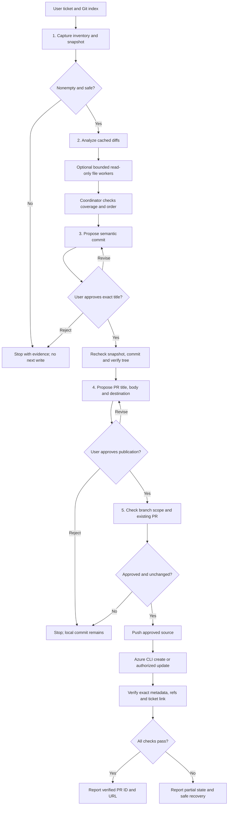

# Architecture

## Execution

## Data Contracts

1. Inventory: `{ticketId: string|null, changes: string[]}`. Paths are repository-relative, use `/` separators and preserve Git case/order. Renames use destination paths; deletions need no existing local file.
2. Descriptions: `{ticketId: string|null, changes: [{filename: string, change_description: string}]}`. Each filename is the identical relative path; exact coverage and order are required.
3. Approved PR: `{title: string, description: string}`. Markdown is a JSON string with escaped newlines, not a fenced machine response.

Approvals, snapshot IDs and destination are outside these public payloads. An object containing valid title/body alone never grants permission to write. Empty inventory is valid JSON but ends orchestration; conflicts or unsafe paths prevent a successful handoff.

## Coordinator State

Pin release, repository root, starting HEAD/unborn marker, branch, index tree ID, rename/status map, ticket and ordered files. Later retain approved title/snapshot, resulting commit ID, metadata, destination, approval evidence and PR ID. Snapshot drift cancels stale analysis and approvals. Hook-modified commit trees block push. Recovery verifies actual state rather than blindly repeating writes.

`git write-tree` creates Git objects but does not stage, commit or alter working files. Other analysis reads Git cached diffs/index/base objects. Working-tree sources are never substituted for indexed content, even when only part of a file is staged. Git path output must be NUL-preserving; lack of a suitable tool is a blocker, not permission to split on spaces.

## Reuse And Parallelism

Each module specifies its inputs, capabilities, output and stop behavior, so it can run standalone with validated context. Shared policy is loaded explicitly. Only per-file description work may fan out, at most four workers at a time. Workers receive authorized staged evidence only; the coordinator validates identity/order and synthesizes cross-file intent. No parallel commit, approval or publication operations.

This is an instruction system, not a deterministic transaction engine or security sandbox. Tool approval, Git hooks and Azure permissions remain necessary. Offline tests inspect recorded simulations and reviewer attestations; real Git/Azure state needs separately authorized integration testing.
